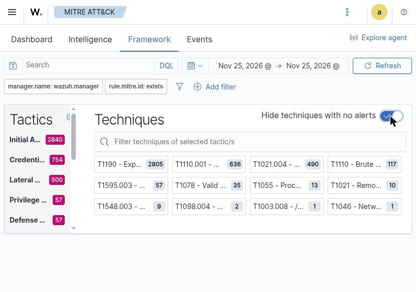
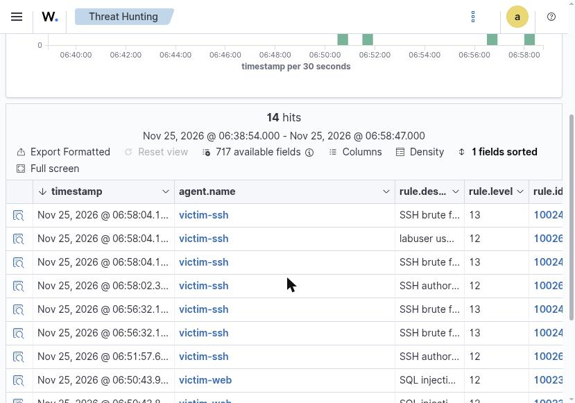
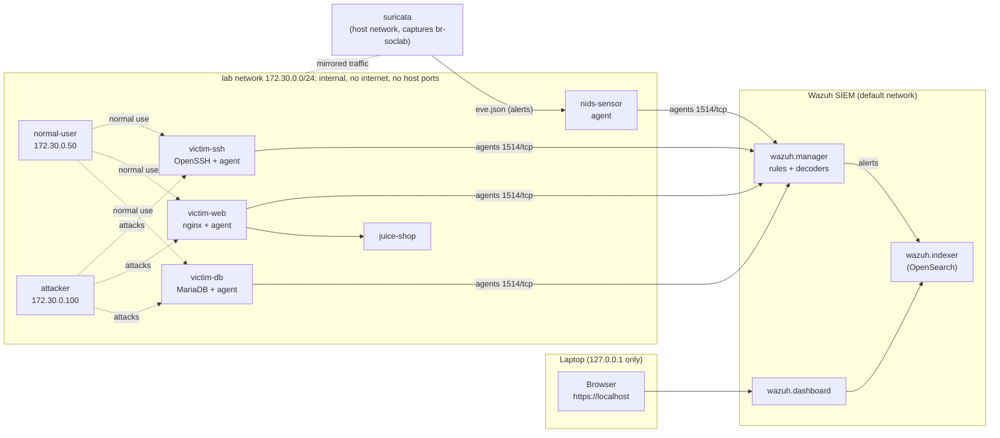

# Home SOC Lab

A reproducible security operations lab on one laptop, built with Docker
Compose: a **Wazuh** SIEM, deliberately vulnerable Linux victims with Wazuh
agents, **Suricata** network detection, an attacker that runs six real
attacks, and a normal-user client for a baseline of legitimate activity.

Every attack has custom detection rules mapped to **MITRE ATT&CK**, measured
against real alerts, and a write-up covering false positives and analyst
response.

**At a glance**

- **What it is:** a SIEM + IDS lab with 3 victims, 1 attacker and 1 normal user, all in Docker.
- **What it shows:** 6 attacks, 8 MITRE ATT&CK techniques, **all detected** within 1–9 seconds.
- **What you need:** a Linux machine with Docker, 8 GB RAM, about 30 minutes for the first run.

**Contents:** [Results](#results) · [Architecture](#architecture) ·
[Quick start](#quick-start) · [Troubleshooting](#troubleshooting) ·
[Documentation](#documentation) · [What building it taught](#what-building-it-taught) ·
[Known limitations](#known-limitations)



*Wazuh's MITRE ATT&CK view during the attack phase. **Red:** the eight techniques the six attacks map to, all detected. **Orange:** T1055, where a stock Wazuh rule wrongly files SQL injection under process injection; the custom rules map it to T1190.*

## Results

| # | Attack | MITRE ATT&CK | Detected by | Level | Time to detect |
|---|--------|--------------|-------------|------:|---------------:|
| 1 | [Port scan](reports/01-port-scan.md) (nmap) | T1046 | 100210 | 10 | 2 s |
| 2 | [Web content discovery](reports/02-web-content-discovery.md) (gobuster) | T1595.003 | 100222 | 10 | 1 s |
| 3 | [SQL injection](reports/03-sql-injection.md) (sqlmap) | T1190 | 100231, 100233 | 12 | 5 s |
| 4 | [SSH brute force → login](reports/04-ssh-brute-force.md) (hydra) | T1110.001, T1078 | 5763 → 100240 | 10 → 13 | 9 s |
| 5 | [Database brute force](reports/05-database-brute-force.md) (hydra) | T1110.001 | 100250 | 12 | 2 s |
| 6 | [Persistence and privilege escalation](reports/06-persistence-privesc.md) | T1098.004, T1548.003, T1003.008 | 100260, 100261 | 12 | 1–2 s |

*Detected by:* the Wazuh rule IDs that fire (100xxx are this lab's custom
rules). *Level:* Wazuh alert severity, 0–15; 12 and above is what an analyst
looks at first.

Before the custom rules, attacks 1 and 2 were not detected at all, attack 5
had no correlation, attack 6 raised only level 3–5 alerts, and Suricata put
every alert at level 3.

**Normal use vs attack** ([full analysis](reports/normal-vs-attack.md)):
ten minutes of legitimate activity produced 88 low-level alerts and nothing
at level 7 or above. The attack phase produced 3,828 alerts, and all 14
alerts at level 12+ fell inside it. The analysis also walks through a
legitimate admin action that fires the same rule as the attacker, and how
context tells them apart.



*Every alert at level 12 or above, over both phases. **Top left:** the ten minutes of normal activity have none. **Centre:** 14 hits, **right:** all at level 12–13, every one inside the attack phase.*

## Architecture



| Component | Version | Role |
|-----------|---------|------|
| Wazuh manager, indexer, dashboard | 4.14.10 | SIEM: analysis, storage, UI |
| Wazuh agents | 4.14.10 | On every victim and on the IDS sensor |
| Suricata | 8.0.8, ET Open (~53,600 rules) | Network IDS on the lab bridge |
| OWASP Juice Shop | v20.4.0 | Vulnerable web application |
| MariaDB | 11.4 LTS | Vulnerable database |
| Debian | 13 (trixie) | Base for victims, sensor, attacker, normal user |

## Quick start

**Requirements:** Linux with Docker Engine and Compose v2, 8 GB RAM (the lab
uses about 5 GB), 4 CPUs, 40 GB free disk.

### Step 1: Prepare the host

The indexer needs `vm.max_map_count` ≥ 262144:

```bash
sysctl vm.max_map_count     # if lower:
echo 'vm.max_map_count=262144' | sudo tee /etc/sysctl.d/99-wazuh.conf && sudo sysctl --system
```

### Step 2: Clone and set up

```bash
git clone https://github.com/Alkindi12/home-soc-lab.git && cd home-soc-lab
./scripts/preflight.sh      # read-only check: RAM, CPUs, disk, max_map_count, Docker
./scripts/setup.sh          # creates .env with random passwords, config, TLS certificates
```

### Step 3: Start the lab

```bash
docker compose build        # victim and sensor images
docker compose up -d        # first start: 2-3 minutes
docker compose ps           # every service should be "running" or "healthy"
```

### Step 4: Log in to the dashboard

Open <https://localhost> (self-signed certificate: accept the browser
warning once). The user is `admin`; the password is generated, read it with:

```bash
grep ^INDEXER_PASSWORD= .env
```

### Step 5: Generate normal activity and attacks

```bash
docker compose --profile normal run --rm normal-user /normal/normal-activity.sh  # 10 min of normal use
docker compose --profile attack build attacker
docker compose --profile attack run --rm attacker /attacks/run-all.sh          # six attacks, ~10 min
```

Each attack can also run on its own, for example
`docker compose --profile attack run --rm attacker /attacks/01-port-scan.sh`.

### Step 6: Investigate the alerts

In the dashboard open **Threat Hunting → Events** and search:

| Query | Shows |
|-------|-------|
| `rule.groups:home_soc_lab` | Only this lab's custom detections |
| `rule.level >= 12` | The alerts an analyst picks up first |
| `data.srcip:172.30.0.100 or data.src_ip:172.30.0.100` | Everything the attacker did (host and Suricata alerts) |

Compare what you find with the [attack reports](reports/README.md).

### Step 7: Stop and clean up

```bash
docker compose stop         # pause, keep everything
docker compose down         # remove containers, keep alerts and Wazuh data
docker compose down -v      # remove everything, including all alerts
```

## Troubleshooting

| Problem | Fix |
|---------|-----|
| Dashboard says "server is not ready yet" | The indexer is still starting: wait 1–2 minutes. |
| Indexer keeps restarting | `vm.max_map_count` is too low: see Step 1. |
| A rule or config change has no effect | `docker compose up -d --force-recreate wazuh.manager` (a plain restart keeps the old config). |
| Login fails after changing `.env` | Passwords are set on first start only. Reset: `docker compose down -v`, `./scripts/setup.sh`, `docker compose up -d`. |
| Dashboard stuck, logs show `Unable to retrieve version information` | Shell variables override `.env`. Open a fresh shell and run `docker compose up -d --force-recreate`. |
| A victim shows no events | `docker compose exec <victim> tail /var/ossec/logs/ossec.log`; on `Duplicate agent name`, recreate the manager, then the victim. |

More detail in each stage's documentation below.

## Safety

- Attacks target only lab containers on an **internal** Docker network: no
  internet access, and Docker refuses to publish its ports on the host.
- Every attack script refuses targets outside the lab subnet.
- The attacker and normal-user containers only start on demand
  (Compose profiles), never with `docker compose up`.
- All Wazuh ports listen on `127.0.0.1`. No real malware is used.
- The victims are deliberately vulnerable. Do not expose them to the
  internet or an untrusted network.
- No password, key or certificate is stored in the repository.
  `scripts/setup.sh` generates them into `.env` (never committed): strong
  random values for Wazuh, and for the victims a deliberately weak one
  picked from the attack wordlist.

## Documentation

| Document | What it covers |
|----------|----------------|
| [docs/stage1-wazuh.md](docs/stage1-wazuh.md) | Wazuh core, hardening vs the upstream setup, troubleshooting |
| [docs/stage2-victims.md](docs/stage2-victims.md) | Victims, agents, enrollment, network isolation |
| [docs/stage3-suricata.md](docs/stage3-suricata.md) | Suricata capture, rules, shipping alerts into Wazuh |
| [docs/stage4-attacks.md](docs/stage4-attacks.md) | Attacker, custom rules, noise tuning, problems found and fixed |
| [reports/](reports/README.md) | One report per attack, plus normal vs attack |

## What building it taught

Most detections first failed **silently**. A few of the problems the lab
caught, all documented with their fixes:

- **The attacker was "inside" the network.** With the attacker in
  Suricata's `HOME_NET`, inbound ET rules could not match: sqlmap raised
  zero network alerts.
- **An agent that shows Active can send nothing.** A rebuilt victim was
  refused re-enrollment ("Duplicate agent name") and went silent.
- **Database detection stopped at 10:00 every day.** MariaDB timestamps
  with a two-digit hour match a stock Windows decoder that wins. Six attack
  tests passed because they ran in the morning; the normal-activity
  baseline found it.
- **Wazuh evaluates sibling rules highest level first**, not in file order,
  so a specific low-level rule never beat a generic high-level one.
- **`docker compose restart` does not apply Wazuh config changes**; the
  manager container has to be recreated.
- **A stock rule maps SQL injection to T1055 Process Injection**; the
  custom rule re-maps it to T1190.

## Repository layout

| Path | Contents |
|------|----------|
| `docker-compose.yml` | The whole lab |
| `wazuh/config/` | Manager, indexer and dashboard configuration |
| `wazuh/rules/`, `wazuh/decoders/` | Custom rules (100000–100999) and decoders |
| `suricata/` | Suricata config, local rules, the `nids-sensor` agent image |
| `victims/` | Victim images (SSH, web proxy, database) with Wazuh agents |
| `attacker/`, `attacks/` | Attacker image, attack scripts, wordlists |
| `normal/` | Normal-activity baseline script |
| `reports/` | Attack reports and the normal-vs-attack analysis |
| `docs/` | Stage documentation and dashboard screenshots |
| `scripts/` | Preflight check and setup |

## Known limitations

- Signature rules (scanner user agents, the sqlmap fingerprint) fall to a
  changed user agent; the rate and campaign rules do not.
- MariaDB does not log successful logins, so a guessed database password is
  seen as failures only.
- Slow attacks stay under the frequency thresholds.
- The Wazuh manager API and enrollment port are reachable from the lab
  network (agents need them); attacks never target them.
- Built and tested on one Linux laptop with 8 GB RAM. Ten minutes of one
  scripted user is a small baseline.

## Project stages

- [x] Stage 0: Host preparation and repository skeleton
- [x] Stage 1: Wazuh SIEM core (manager, indexer, dashboard)
- [x] Stage 2: Victim containers with Wazuh agents
- [x] Stage 3: Suricata network detection forwarded into Wazuh
- [x] Stage 4: Attacks, custom rules, MITRE ATT&CK mapping, normal-activity baseline
- [x] Stage 5: Documentation and v1.0 release
