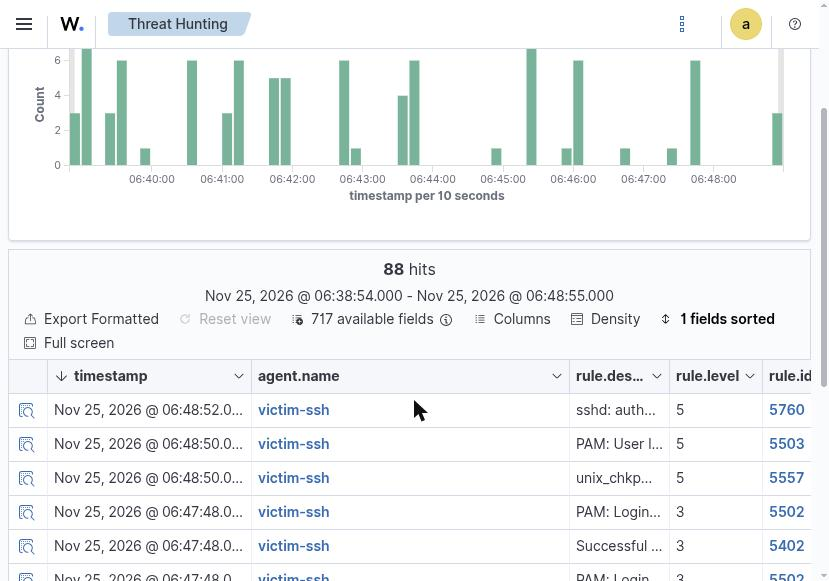
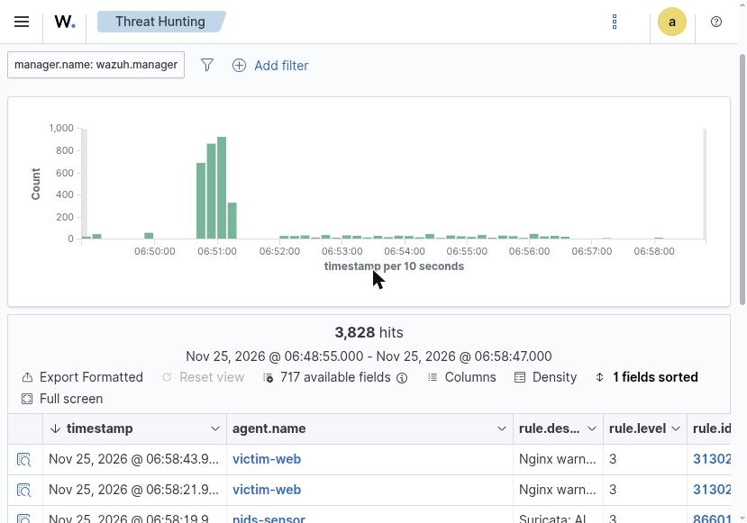
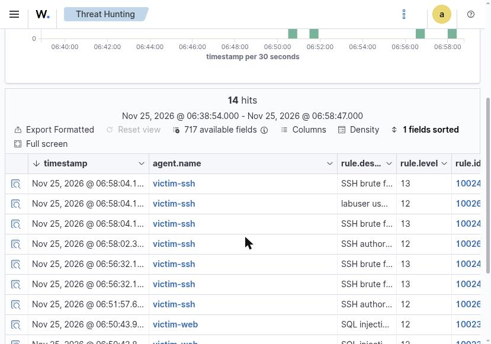
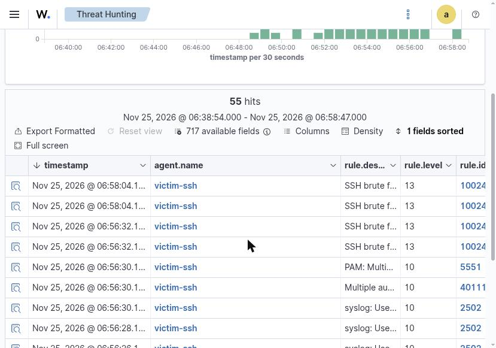
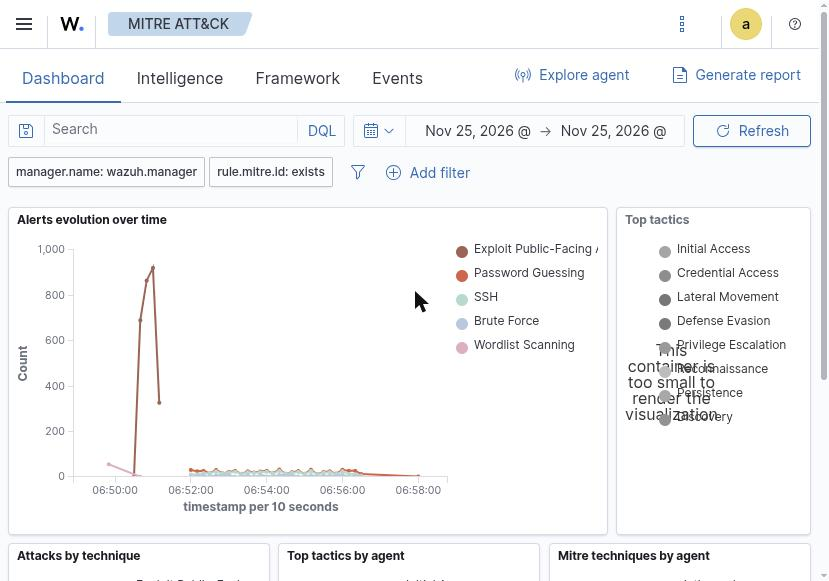
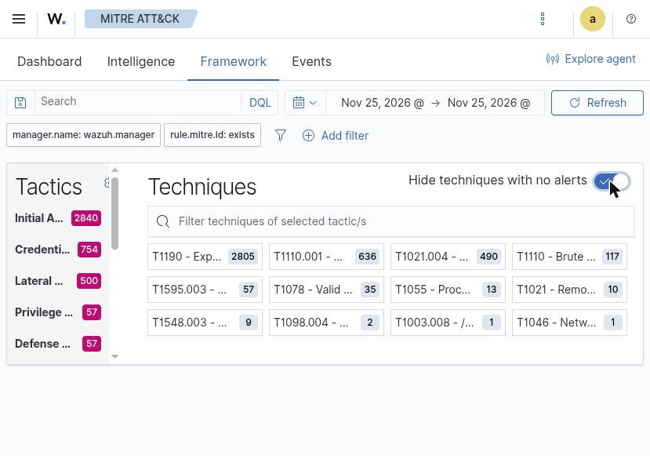
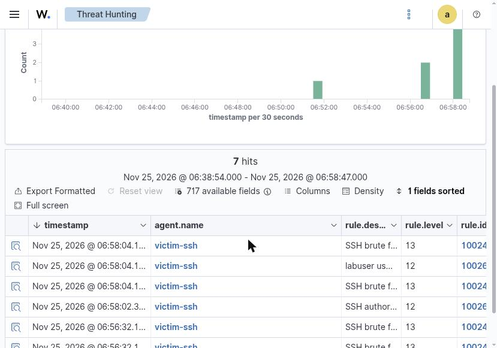
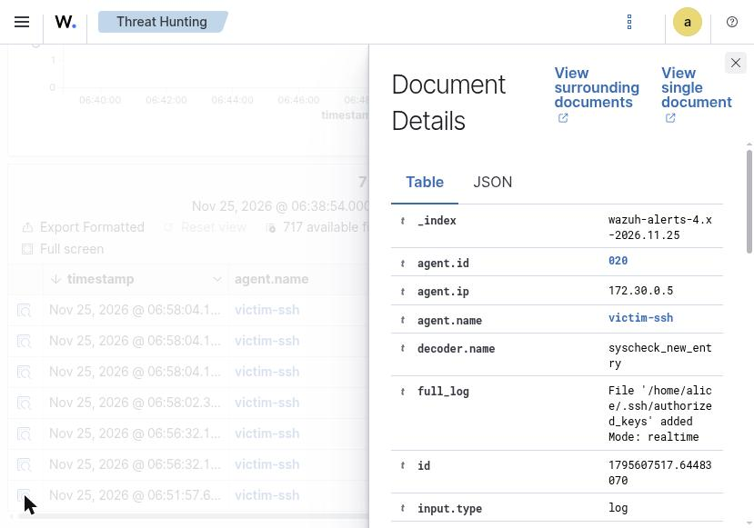
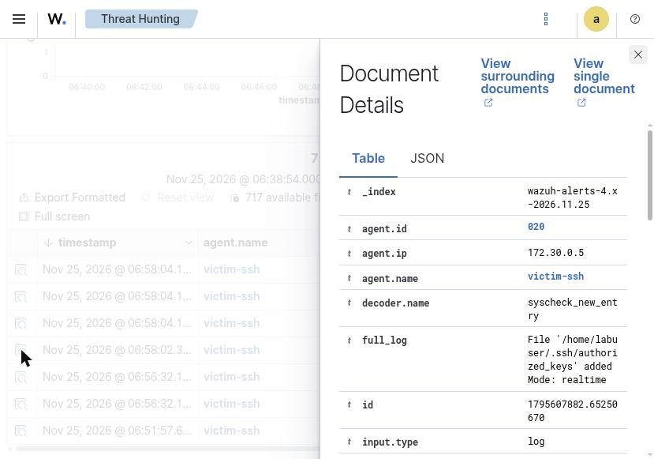

# Normal activity vs attack: reading the SIEM like an analyst

Alerts only mean something against a baseline. This exercise runs the lab
the way legitimate users do for 10 minutes, then runs all six attacks while
that normal activity carries on, and compares what Wazuh shows in each
phase. It also walks through how an analyst separates one from the other,
including a legitimate action that fires the same rule as an attack.

## Setup

| | Normal user | Attacker |
|---|---|---|
| Container | `normal-user` (hostname `workstation`) | `attacker` |
| Address | `172.30.0.50` | `172.30.0.100` |
| Credentials | strong, generated by `setup.sh` | none: guesses them |
| Script | [`normal/normal-activity.sh`](../normal/normal-activity.sh) | [`attacks/run-all.sh`](../attacks/run-all.sh) |

What the normal user does, at human pace (8–25 s between actions, every
action logged with a timestamp in `attacks/output/normal-activity.log`):

| Activity | Detail |
|----------|--------|
| Shopping | Browser user agent; home page and its assets, a product search ("apple", "banana", ...), a product page and its reviews |
| Customer login | Registers once, then logs in to the shop, views account and saved cards |
| Admin SSH | `alice` logs in to victim-ssh with her own password, runs `uptime`, `df`, `free`, and `sudo tail /var/log/auth.log`. **1 session in 4 starts with a mistyped password** |
| Application database | `shopapp` inserts an order and reads the order count. **1 run in 5 first uses a stale password** |
| One legitimate change | Halfway through, `alice` adds the key of her new laptop to `~/.ssh/authorized_keys`: the same action as attack 6 |

## Timeline

Times as shown on the dashboard clock in the screenshots (2026-11-25).

| Phase | Window | What ran |
|-------|--------|----------|
| **A: normal only** | 06:38:54 – 06:48:55 (10 min) | normal user |
| **B: attack** | 06:48:55 – 06:58:47 (10 min) | the six attacks, normal user still active |

## The numbers

SCA configuration checks are excluded throughout (see Stage 4 noise tuning).

| | Phase A: normal | Phase B: attack |
|---|---:|---:|
| Alerts | **88** | **3,828** |
| Rate | 9 / min | 388 / min (43×) |
| Level 0–6 | 88 | 3,591 |
| Level 7–11 | **0** | 223 |
| Level 12+ | **0** | 14 |

Phase B by source:

| Source | Alerts | Level 7–11 | Level 12+ |
|--------|-------:|-----------:|----------:|
| attacker `172.30.0.100` | 3,546 | 131 | 11 |
| normal user `172.30.0.50` | 26 | 0 | 0 |
| no source IP (FIM, sudo, PAM) | 211 | 83 | 3 |
| other (Suricata internal legs) | 45 | 9 | 0 |

The three level-12 alerts without a source IP are host events: the
attacker's `authorized_keys` change and `/etc/shadow` read, **and alice's
legitimate key change**. Telling those apart is covered below.



*Phase A, normal activity only. **Top:** a few events every half minute,
no spikes. **Centre:** 88 alerts in ten minutes. **Right:** every one at
level 3–5.*



*Phase B, the attack. **Circled:** the sqlmap burst, about 900 alerts in
ten seconds. **Boxed:** 3,828 alerts in ten minutes, 43 times the normal
rate.*



*Only alerts at level 12+, across both phases. **Top left:** the normal
phase has none. **Centre and right:** 14 alerts at level 12–13, all inside
the attack phase.*

## What normal looks like

The complete normal baseline, all 88 alerts in Phase A:

| Count | Rule | Level | Meaning |
|------:|------|------:|---------|
| 18 + 18 | 5501 / 5502 | 3 | PAM session opened / closed (alice's SSH sessions) |
| 9 | 5715 | 3 | SSH login success, from `172.30.0.50` |
| 8 | 5402 | 3 | Successful sudo to root (`tail /var/log/auth.log`) |
| 8 | 31302 | 3 | nginx warnings (large Juice Shop responses buffered) |
| 4 + 4 + 4 | 5760 / 5503 / 5557 | 5 | alice's mistyped password: **one** failure, then success |
| 10 | 86601 | 3 | Suricata TCP stream anomalies (normal container traffic) |
| 3 | 31101 | 5 | HTTP 400 (shop registration of an existing account) |
| 1 + 1 | 554 / 5403 | 5 / 4 | First sudo by alice creates `~/.sudo_as_admin_successful` |

Normal looks like this:
- **low levels only**: nothing at 7 or above in ten minutes;
- **a steady rhythm**: a few events every half minute, no spikes;
- **successes outnumber failures**, and every failure is followed by a
  success from the same user and address within seconds;
- **one known source** per activity, using real usernames and a browser
  user agent.

## How the attack stands out

| Signal | Normal (Phase A) | Attack (Phase B) |
|--------|------------------|------------------|
| **Volume and rate** | 9 alerts/min, flat | 388/min; about 900 alerts in 10 s during sqlmap |
| **Severity** | all ≤ 6 | 237 at ≥ 7, 14 at ≥ 12 |
| **Correlation rules** | none fired | port scan, web scan, SQLi campaign, SSH and DB brute force, brute force *succeeded* |
| **SSH failures** | alice: 1 failure → success, real user | 428 attempts on **non-existent** users (`oracle`, `postgres`, ...), 60+ wrong passwords, then success |
| **sudo** | `sudo tail /var/log/auth.log` (5402, level 3) | `sudo cat /etc/shadow` (100261, level 12) |
| **Web** | browser user agent, ~10 requests per visit | `gobuster/3.6`, 55 paths in 1 s; `sqlmap`, 1,400 injection requests in 35 s |
| **Database** | one stale password → retry → success | 25 failed `root` logins in 1 s |
| **Sequence** | unrelated routine actions | a kill chain: scan → discovery → exploit → brute force → login → persistence → credential access |



*Pivot on the attacker's address. **Boxed:** 55 alerts at level 10+ come
from `172.30.0.100`, from brute force (level 10) up to "brute force
succeeded" (level 13).*



*MITRE ATT&CK dashboard for the attack phase. **Circled:** the SQL injection
spike (T1190, Exploit Public-Facing Application). **Boxed:** the other
techniques seen: password guessing, SSH, brute force, wordlist scanning.*



*MITRE ATT&CK techniques with alerts. **Red:** the eight techniques the
attacks map to, all detected. **Orange:** T1055, the stock rule's mis-mapping
of SQL injection (see [report 03](03-sql-injection.md)).*

## The hard case: the same rule for a user and an attacker

Rule 100260 ("SSH authorized_keys created or changed", level 12) fired
**twice**, both on victim-ssh:

| | 06:51:57 | 06:58:02 |
|---|---|---|
| File | `/home/alice/.ssh/authorized_keys` | `/home/labuser/.ssh/authorized_keys` |
| Before it | alice's routine logins, nothing unusual | ~300 failed logins, then **100240 SSH brute force succeeded** for `labuser` |
| After it | more routine admin activity | **100261** `sudo cat /etc/shadow` 2 s later |
| Source of the session | `172.30.0.50`, alice's usual workstation | `172.30.0.100`, the address behind every alert in the attack |
| Verdict | **benign**: confirm with alice | **true positive**: account compromised |



*Rules 100240, 100260 and 100261 over time. **Left circle:** alice's key
change at 06:51, alone. **Right circle:** the attack chain at 06:56–06:58:
brute force succeeded, key planted, `/etc/shadow` read.*

| alice (legitimate) | labuser (attacker) |
|---|---|
|  |  |
| *Boxed: the file is in `/home/alice`: her own key, from her own session.* | *Boxed: the file is in `/home/labuser`: the account the attacker just broke into.* |

A single alert does not tell them apart. **Context does**: what happened
to the same account and host just before and just after.

## Reading the results in real life: a triage walk-through

1. **Start at the top.** Filter `rule.level >= 12` over the shift. In this
   20-minute run that is **14 alerts out of 3,916**: the queue a human
   actually reads first.
2. **Group by source.** `data.srcip` / `data.src_ip`: 11 of those 14 point
   to `172.30.0.100`. One unknown address behind most high alerts is the
   first strong signal.
3. **Pivot on that source.** `data.srcip:172.30.0.100 or data.src_ip:172.30.0.100`
   with `rule.level >= 10`: 55 alerts, which, sorted by time, read as the
   attack story from scan to brute force.
4. **Check for success, not just attempts.** Rules that mean *it worked*:
   100240 (SSH login after brute force), 100231/100233 with HTTP 200
   (injection answered), 100260/100261 (post-compromise actions). They turn
   "under attack" into "incident".
5. **Handle alerts without an IP by context.** Host events (FIM, sudo) have
   no source address. Look at the same agent and user in the minutes around
   them, as in the case above.
6. **Compare with the baseline.** Anything in Phase A's table above at its
   usual rate is routine. Anything not in it, or far above its rate, needs
   an explanation.

## Gap found while running this exercise

Phase B produced **no database alerts**: the attacker guessed the MariaDB
root password unseen. The cause was in the Stage 2 decoder. From 10:00
each day, MariaDB's timestamp (`2026-11-25 11:57:35`) also matches Wazuh's
stock `windows-date-format` decoder, which is tried first. Every test before
had run before 10:00, with a space-padded hour (`2026-11-25  7:51:16`).
Fixed with a second decoder path and rules 100251/100252 (details in
[report 05](05-database-brute-force.md)). Re-running attack 5 alongside
normal activity after the fix: **100250 (level 12)** plus 25 × 100251
(level 9), all with `srcuser=root`, `srcip=172.30.0.100`.

A baseline exercise found a bug that six attack tests had missed. This is
why detections should be tested at different times and against normal
traffic, not only against attacks.

## Limits of this baseline

- Ten minutes of one scripted user is a tiny baseline. Real baselines
  cover weeks, working hours vs nights, and many users.
- The normal user sits inside Suricata's `HOME_NET` and the attacker
  outside it, so the network IDS treats them differently by design. An
  insider attacking from `172.30.0.50` would raise far fewer Suricata alerts.
- Scripted "humans" are regular; real users are messier. Thresholds tuned
  here should be checked against real traffic before production.

## Reproduce

```bash
docker compose --profile normal run -d --rm --name soc-normal -e DURATION=1560 \
  normal-user /normal/normal-activity.sh
sleep 600
docker compose --profile attack run --rm attacker /attacks/run-all.sh
```
